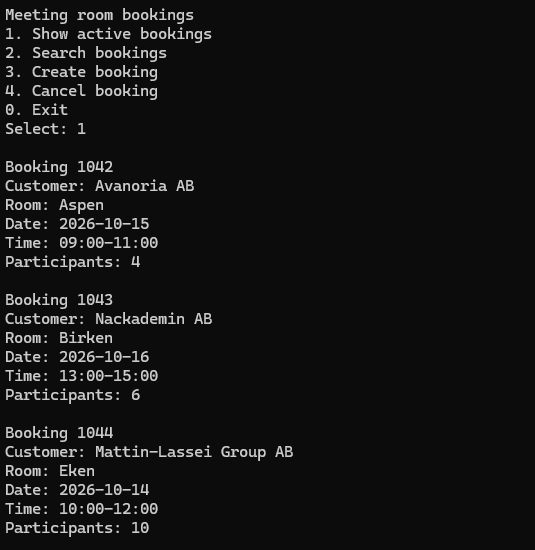
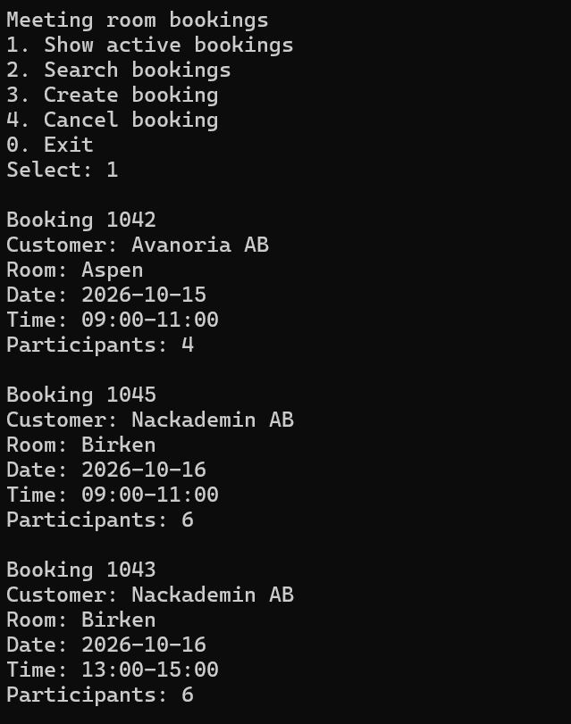

## Buggar

# Debuggfall – Buggrapport

Nedan följer dokumentation av ett specifikt debuggarbete.  
Strukturen är avsedd att vara enkel, konsekvent och lätt att följa.

---

## 🐞 Vilket fel undersökte du?
001 - Visa alla aktiva bokningar.  

---

## 🔁 Hur återskapade du felet?
1. Starta applikationen.
2. Välj alternativ 1 i menyn [Show active bookings]
3. Bokningarna visas

---

## Screenshot - Före
Här visas inaktiva bokningar och fel sortering.  
  

## 📌 Vilket resultat fick du?
Jag fick en lista på alla boknginarna som finns i systemet, den visade även bokningar som är ```IsCancelled == true```, samt att den inte listade boknignana i rätt följd.

---

## 🎯 Vilket resultat skulle du ha fått?
Jag skulle ha fått en lista på de bokningarna som är aktiva i systemet, dvs inte avbokade möten. De skulle även listas efter datum ordning 
och vid flera bokningar samma dag ska de boknigarna listas efter starttid.

---

## 🧩 Vilken del av koden orsakade felet?
- Här kan vi se att metoden GetActiveBookings inte är färdig, den ger tillbaka alla bokningar rakt av, ingen filtrering eller sortering av bokningarna görs.  
```csharp
   public IReadOnlyList<Booking> GetActiveBookings()
    {
        // This method has not been completed.
        return repository.GetAll();
    }
```

---

## 🧩 Hur fixades buggen?
- Första prblemet med att alla bokningar visades kan lösas med att endast plocka ut de aktiva bokningarna, därefter la jag till en metod som sorterar bookningarna efter
datum och därefter starttid. Jag lade till en till bokning 1045 i *bookings.json* med samma startdatum men en tidigare tid än 1043 för att se att filtreringen fungerade som den ska.
Den cancelerade bokningen 1044 ligger kvar i *bookings.json* men visas inte.
```csharp
  public IReadOnlyList<Booking> GetActiveBookings()
    {
        var activeBookings = repository.GetAll().Where(booking => booking.IsCancelled == false);
        return SortBookingsByDateAndStartTime(activeBookings);
    }

    private static List<Booking> SortBookingsByDateAndStartTime(IEnumerable<Booking> activeBookings)
    {
        return activeBookings.OrderBy(booking => booking.Date).ThenBy(booking => booking.StartTime).ToList();
    }
```   
-  Jag kan även se att testet ```GetActiveBookings_ReturnsOnlyActiveBookingsSortedByDateAndStartTime()``` efter ändringarna går igenom. Testet skapar ett antal boknignar och kollar att
```GetActiveBookings()``` retunerar en lista på endast aktiva möten samt i rätt sortering, listan skapas inte heller med möten i rätt ordning så det krävs sorteringen för att testet ska gå igenom.

---

## Screenshot - Efter
Här visas aktiva bokningar i rätt ordning.  
 