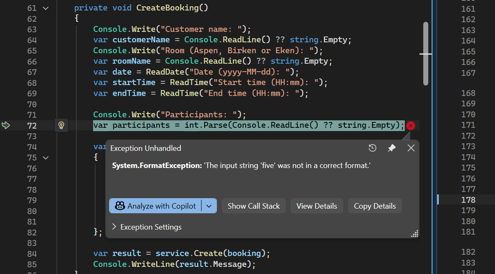

# Debuggfall – Buggrapport
---

## 🐞 Vilket fel undersökte du?
004 - Programmet kraschar vid felaktigt deltagarantal 

---

## 🔁 Hur återskapade du felet?
1. Starta applikationen.
2. Välj alternativ 3 i menyn [Create booking]
3. Mata in efterfrågad information fram till participant
4. Skriv in "five"
---

## Screenshot - Före
Här kastas exceptiono och applikationen kraschar. 
  

## 📌 Vilket resultat fick du?  
Applikationen kastar ett ``` FormatException ``` och stänger ner.

---

## 🎯 Vilket resultat skulle du ha fått?
Användaren skulle ha fått information om vad som gick fel och fick försöka igen och skriva in en siffra nästa försök.

---

## 🧩 Vilken del av koden orsakade felet?
- I filen ```BookingConsole.cs``` kan vi se att värdet vi skriver in i konsolen för participants parsas direkt utan att kolla om en parse är möjlig. ```int.Parse()``` 
behöver en sträng i format av ett heltal för att fungera t.ex. ```"5"``` därför krashar det eftersom att vi skickar in ```"five"```.  
```csharp
        Console.Write("Participants: ");
        var participants = int.Parse(Console.ReadLine() ?? string.Empty);
```

---

## 🧩 Hur fixades buggen?
- Genom att skapa en metod för att validera och hantera Participant inputen och i den lägga ```int.TryParse(input, out participants)```
istället för att köra ```int.Parse()``` så kan vi också skriva ut ett meddelande till användaren att det måste vara ett nummer.
För att underlätta lade jag också till så att vi visar och kollar att värdet är gilltigt för det valda rummet redan här. 
Så att vi får snabb feedback på om det är ett giltigt nummer.
```csharp
      private int InputParticipants(string roomName)
    {
        int participants;
        var maxNumberInRoom = service.MaxParticipantsInRoom(roomName);

        while (true)
        {
            Console.WriteLine($"(For {roomName} enter a number between 1 and {maxNumberInRoom})");
            Console.WriteLine("Enter number of participants: ");
            var input = Console.ReadLine();

            if (int.TryParse(input, out participants) && participants > 0 && participants <= maxNumberInRoom)
                break;

            Console.WriteLine($"Participants must be a number greater than 0 and maximum {maxNumberInRoom}.");
        }

        return participants;
    }
```   
-  Jag kan inte se att något av testen hittade den här buggen då testet för participants ```Create_WhenParticipantCountExceedsCapacity_ReturnsFailure()```
tar en int när den skapar testbokningen och kollar så att man inte kan ha för många deltagare för det valda mötesrummet. 
Och alla metoder i ```BookingConsole.cs``` är privata och har inga tester. 
---

# Alternativa Lösningar
---

## Valideringsflöde

Jag ändrade i flödet för Create booking. Jag ville göra en bättre användarupplevelse genom att få direkt feedback och validering på den
input användaren anger vid skapandet av en bookning. Att man t.ex. direkt ska få feedback och rätta till ifall man skriver 
in ett felaktigt namn, eller deltagarantal. Istället för att gå igenom hela flödet och sedan få ett felmeddelande att bokningen inte kunde skapas.
Jag försökte också ta bort den mesta av den logiken från själva CreateBooking metoden och istället flytta ut det till egna metoder så som
```InputCustomerName()```, ```InputParticipants(roomName)``` liknande de som redan fanns, ```ReadDate``` och  ```ReadTime```.
Jag lade till en alternativ parameter i ```ReadTime(string prompt, TimeOnly? meetingStartTime = null)``` där jag kan skicka med starttiden när jag
vill sätta sluttiden. På så sätt kan jag validera att sluttiden sätts efter starttiden dirket vid inmatning.
Jag lade också in så att mötesrummet väljs genom att trycka på siffra 1-3 istället för att skriva namnet. 
Jag Gjorde även en metod för att hämta ut max antal deltagare för ett specifikt rum 
```csharp
    public int MaxParticipantsInRoom(string roomName)
    {
        if (Rooms.TryGetValue(roomName, out var room))
            return room.Capacity;

        throw new ArgumentException($"Room '{roomName}' does not exist.");
    }
```  
som använde för att ge mer information till användaren om hur många deltagre som får plats i rummet som håller på att bokas, det används också
för valideringen av participants. 

---
## Update i Repository

Jag märkte att det inte fanns någon funktion för att uppdatera en bokning, vilket jag ville göra när jag skulle cancelera en bookning.
Jag la till ```void Update(Booking booking);``` i ```IBookingRepository``` och i ```FileBookingRepository``` la jag till logik för att hämta ut
den bokningen jag ville uppdatera samt ändra den i den lokala listan och efter att jag kallat på Update så kallar jag på Save på samma sätt
som Create var implementerad. I Test repositoriet ```InMemoryBookingRepository.cs``` la jag till den som en tom metod då den inte direkt användes i testet,
utan det kollar så vi får lyckat resultat, att bookningen ```IsCancelled``` och att ```Save()``` har körts.
